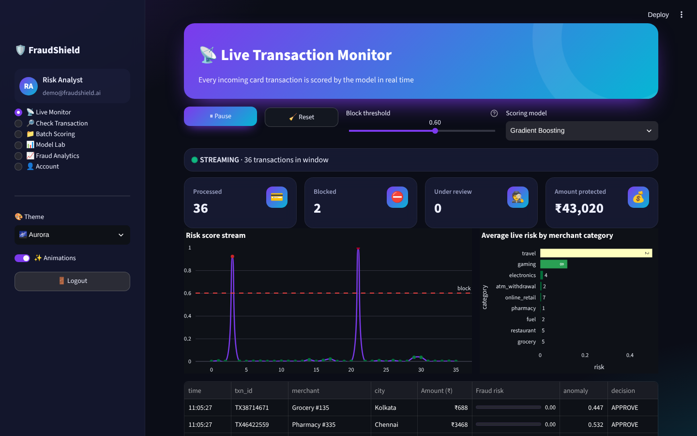
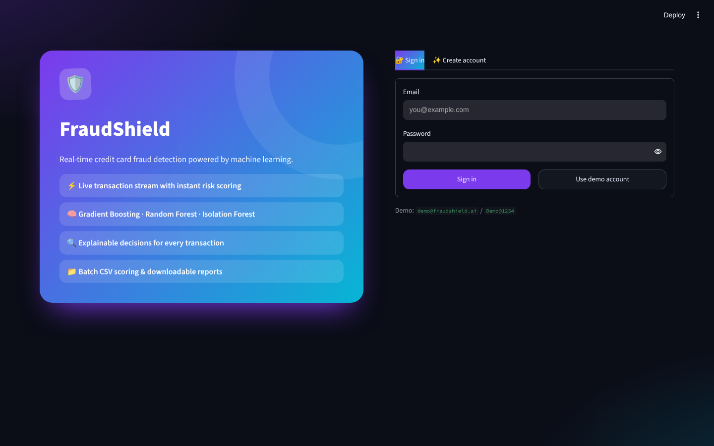
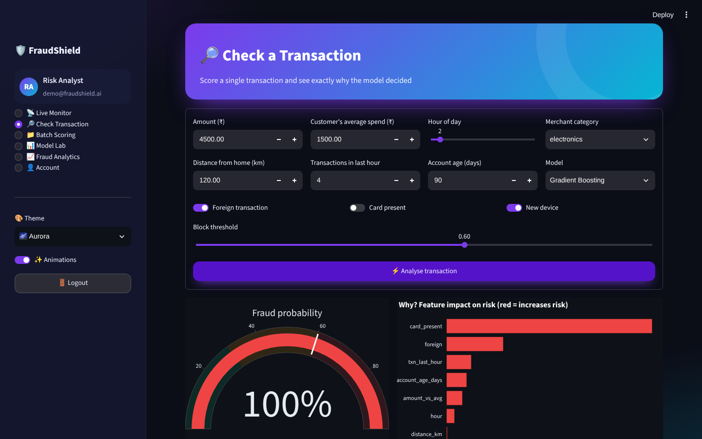
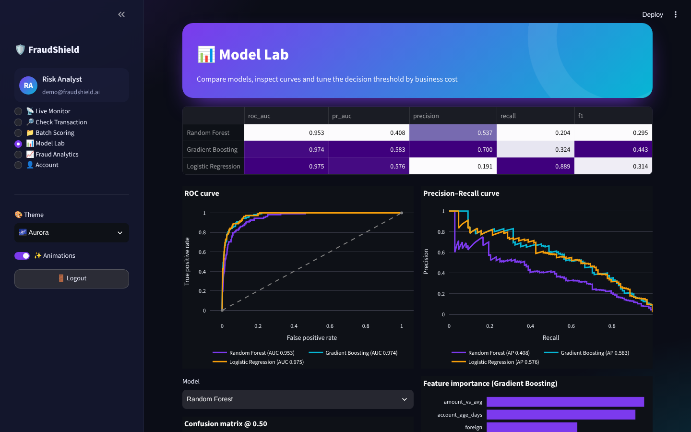
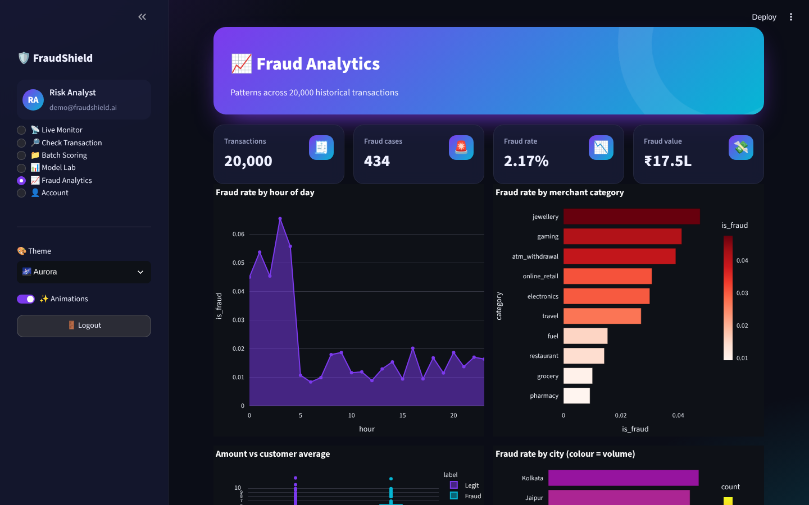
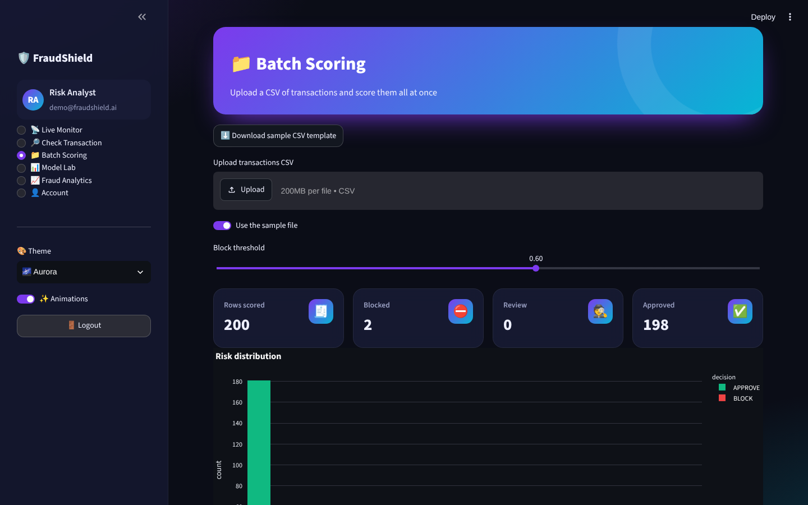

<div align="center">

# 🛡️ FraudShield

### Real-time credit card fraud detection with machine learning — live transaction stream, explainable risk scores & model lab


</div>



## ✨ Features

| Module | Highlights |
|---|---|
| 🔐 **Register / Login** | SQLite user store, salted **PBKDF2-SHA256** password hashing, password-strength meter, validation, demo account, activity log, change password |
| 📡 **Live Monitor** | Real-time stream of card transactions (auto-refreshing fragment), every transaction scored instantly, start/pause/reset, adjustable block threshold, model switcher, live KPIs, risk-score stream chart, category risk bars, alert feed |
| 🔎 **Check Transaction** | Score any transaction: animated gauge, APPROVE / REVIEW / BLOCK decision, Isolation-Forest anomaly score and a **local explanation** of which features pushed the risk up or down |
| 📁 **Batch Scoring** | Upload a CSV (template provided), score thousands of rows, risk histogram, download results |
| 📊 **Model Lab** | Gradient Boosting vs Random Forest vs Logistic Regression — ROC-AUC, PR-AUC, precision, recall, F1, ROC & PR curves, confusion matrix, feature importance, **threshold tuning by business cost** |
| 📈 **Fraud Analytics** | Fraud rate by hour, merchant category, city; amount-vs-average distributions |
| 🎨 **Themes & animations** | 5 colour themes (Aurora, Ocean, Sunset, Emerald, Midnight), glassmorphism cards, animated hero, pulsing live indicator, page transitions, animation toggle |

## 🧠 How it works

1. **Data** – 20,000 realistic synthetic transactions (amount, amount vs customer average, hour, distance from home, velocity, account age, foreign, card-present, new device, merchant risk) with a ~2–3 % fraud rate produced by a logistic risk model, so the project runs with no downloads.
2. **Models** – class-balanced Gradient Boosting, Random Forest and Logistic Regression, plus an **Isolation Forest** trained only on legitimate transactions for zero-day anomaly detection.
3. **Evaluation** – stratified hold-out set; PR-AUC is reported because fraud is highly imbalanced.
4. **Explainability** – each feature is reset to the population mean and the change in fraud probability is measured.
5. **Streaming** – new transactions (with injected attack patterns) arrive every 1.5 s and are scored by the selected model.

## 🖼️ Screenshots

| Login | Check transaction | Model lab |
|---|---|---|
|  |  |  |

| Fraud analytics | Batch scoring |
|---|---|
|  |  |

## 🚀 Run locally

```bash
git clone https://github.com/PreciousBharath/FRAUDSHIELD-REALTIME-FRAUD-DETECTION.git
cd FRAUDSHIELD-REALTIME-FRAUD-DETECTION
pip install -r requirements.txt
streamlit run app.py
```

Click **Use demo account** (`demo@fraudshield.ai` / `Demo@1234`) or create an account.

## 🧱 Project structure

```
├── app.py              # Streamlit app: pages & UI
├── core/
│   ├── engine.py       # data generator, training, scoring, explanation, live stream
│   ├── auth.py         # SQLite users, PBKDF2 hashing, login/register UI, activity log
│   └── ui.py           # themes, CSS animations, KPI cards, Plotly template, sidebar
├── .streamlit/config.toml
└── requirements.txt
```

## 📄 License

MIT © [Bharath](https://github.com/PreciousBharath)
